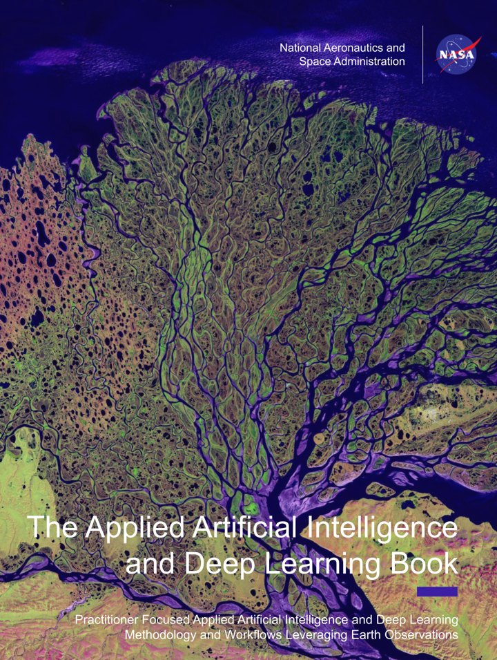

Geospatial Artificial Intelligence Working Group

# Geo-AI Working Group

Open lectures, shared learning and practical tools for applying AI to Earth observation and geospatial data: a community of researchers, practitioners and developers since 2019.

[:material-book-open-page-variant: Read the Book](https://nasa-earthrise.github.io/EarthRISE-Applied-Artificial-Intelligence-and-Deep-Learning-Book/){ .md-button .md-button--primary }
[:material-calendar: Lectures](lectures/index.md){ .md-button }
[:fontawesome-brands-youtube: Watch talks](talks/index.md){ .md-button }

New · Open textbook · CC BY 4.0

--8<-- "stats.md"

Featured · Open textbook

## The EarthRISE Applied Artificial Intelligence & Deep Learning Book

The product of more than seven years of Geo-AI Working Group knowledge sharing: notebook-driven chapters on remote-sensing AI across NASA Earth Action themes, from semantic segmentation and time series to Bayesian deep learning and evaluating Earth-observation foundation models. Free and open.

[Open the book →](https://nasa-earthrise.github.io/EarthRISE-Applied-Artificial-Intelligence-and-Deep-Learning-Book/){ .md-button .md-button--primary } [Chapters](book.md){ .md-button } [Cite · DOI](https://doi.org/10.5281/zenodo.20547797){ .md-button }

--8<-- "next.md"

## Latest talks

--8<-- "latest-talks.md"

[All recorded talks →](talks/index.md)

### :material-microphone: Lectures
Biweekly talks with analytics across every year of the series.
[Schedule & charts](lectures/index.md) · [Archive](talks/index.md)

### :material-school: Capacity Building
A learning path from ML basics to TensorFlow and Earth Engine.
[Start learning](capacity-building.md)

### :material-folder-open: Resources
Presentations, scripts and regional materials from the WG.
[Browse resources](resources.md)

### :material-calendar-star: Events
Conferences, workshops and deadlines in geospatial AI.
[Events](events/index.md) · [RSS](feeds/events.xml)

## Upcoming events

--8<-- "upcoming.md"
